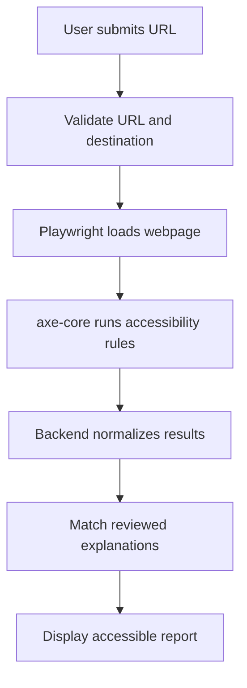

# Scanly: AI Accessibility Auditor

Scanly is an AI-assisted web accessibility auditing tool that helps student developers and campus organizations identify common accessibility barriers on their websites.

Users submit a webpage URL, and Scanly scans the page using Playwright and axe-core. It then presents the findings in an accessible, beginner-friendly report with plain-language explanations, affected elements, trusted resources, and suggested fixes.

> **Important:** Scanly provides automated accessibility guidance. It does not replace a complete manual accessibility audit and does not certify legal or WCAG compliance.

---

## Table of Contents

- [Project Overview](#project-overview)
- [The Problem](#the-problem)
- [Our Solution](#our-solution)
- [Responsible AI Approach](#responsible-ai-approach)
- [How Scanly Works](#how-scanly-works)
- [MVP Features](#mvp-features)
- [Project Limitations](#project-limitations)
- [Technology Stack](#technology-stack)
- [System Architecture](#system-architecture)
- [Data Structure](#data-structure)
- [API Design](#api-design)
- [Repository Structure](#repository-structure)
- [Getting Started](#getting-started)
- [Environment Variables](#environment-variables)
- [Testing](#testing)
- [Security](#security)
- [Accessibility Requirements](#accessibility-requirements)
- [Project Timeline](#project-timeline)
- [Team Roles](#team-roles)
- [Development Workflow](#development-workflow)
- [Definition of Done](#definition-of-done)
- [Trusted Resources](#trusted-resources)
- [Contributing](#contributing)
- [License](#license)

---

## Project Overview

Many student-built and campus organization websites are never tested for accessibility. Developers may not know how to test their websites with a screen reader, identify low color contrast, check keyboard navigation, or understand technical WCAG requirements.

This can prevent blind, low-vision, motor-impaired, and other disabled users from accessing information and completing important tasks.

Scanly is designed to make automated accessibility testing more approachable. Instead of displaying only technical scanner output, it explains:

- What the issue is.
- Where the issue appears.
- Who may be affected.
- Why the issue matters.
- How the developer can begin fixing it.
- Which trusted accessibility resource provides more information.

---

## The Problem

Common website accessibility barriers include:

- Images without alternative text.
- Form fields without accessible labels.
- Links or buttons without accessible names.
- Text with insufficient color contrast.
- Incorrect heading structure.
- Invalid ARIA attributes.
- Missing page-language information.
- Content that cannot be operated using a keyboard.
- Confusing focus order or invisible focus indicators.

Accessibility scanners can detect some of these problems, but their output is often difficult for beginning developers to understand.

Automated tools also cannot detect every accessibility issue. Some requirements must be evaluated manually using keyboard navigation, screen readers, and human judgment.

---

## Our Solution

Scanly will provide:

1. A URL submission form.
2. Secure validation of the submitted URL.
3. Browser automation using Playwright.
4. Automated accessibility testing using axe-core.
5. Normalized and structured scan results.
6. Plain-language explanations of detected issues.
7. Suggested fixes and example code.
8. Links to trusted WCAG and accessibility guidance.
9. A separate manual-review checklist.
10. An accessible and responsive report interface.

The initial MVP will scan one publicly accessible webpage at a time.

---

## Responsible AI Approach

Scanly separates **accessibility detection** from **AI explanation**.

### Deterministic detection

Playwright and axe-core determine which automated accessibility issues are present.

The AI does **not**:

- Decide whether a violation exists.
- Change the axe-core rule ID.
- Change the reported impact level.
- Invent WCAG requirements.
- Generate an accessibility score.
- Declare a website fully accessible.
- Certify legal or WCAG compliance.

### Grounded explanations

The AI receives only:

- The axe-core rule ID.
- The rule description.
- The reported impact.
- WCAG-related tags.
- The axe-core help URL.
- A limited and sanitized affected-element snippet.
- Approved accessibility guidance for that rule.

The AI then produces structured explanations covering:

- What the problem means.
- Who may be affected.
- Why the problem matters.
- A suggested fix.
- A short example when appropriate.

### Reviewed explanation catalog

Scanly will maintain a reviewed explanation catalog keyed by axe-core rule ID.

The recommended workflow is:

1. The AI generates an initial explanation draft.
2. A team member checks it against the original accessibility guidance.
3. The explanation is marked as reviewed.
4. Scanly reuses the approved explanation for future scans.
5. If no reviewed explanation exists, Scanly uses a safe fallback instead of presenting unsupported information.

This produces more consistent results, reduces API usage, and makes the system easier to evaluate.

---

## How Scanly Works



### Detailed workflow

1. The user enters a public webpage URL.
2. The backend confirms that the URL is valid and safe to scan.
3. Playwright launches an isolated browser page.
4. The webpage is loaded with time and size limits.
5. axe-core evaluates the rendered webpage.
6. The backend separates violations, incomplete results, passes, and errors.
7. Results are converted into Scanly’s shared data structure.
8. Each rule is matched with a reviewed plain-language explanation.
9. The frontend displays the report by impact and category.
10. Scanly shows automated limitations and recommended manual checks.

---

## MVP Features

### URL scanning

- Submit one public `http` or `https` URL.
- Validate the URL before opening it.
- Handle redirects safely.
- Display clear loading and error states.
- Stop scans that exceed configured limits.

### Automated accessibility testing

- Run axe-core against a rendered webpage.
- Record the axe-core rule ID.
- Preserve axe-core impact levels.
- Record WCAG-related tags.
- Identify affected elements.
- Preserve the original help URL.
- Separate violations from incomplete results.

### Report interface

- Summary of detected issues.
- Issue counts by impact.
- Filters by impact or category.
- Expandable violation details.
- Affected selector and HTML snippet.
- Plain-language explanation.
- Suggested fix.
- Trusted source link.
- Separate manual-review section.
- Downloadable or exportable report if time permits.

### AI explanation layer

- Structured JSON responses.
- Grounded prompts.
- Approved rule explanation catalog.
- Human review status.
- Safe fallback explanations.
- Accuracy and usefulness evaluation.

### Manual-testing guidance

- Keyboard-only testing checklist.
- Screen-reader testing checklist.
- Focus-order guidance.
- Form and error-message review.
- Instructions for checking content that automated tools cannot evaluate.

---

## Project Limitations

The initial version of Scanly will not:

- Guarantee that a website is accessible.
- Replace disabled users in usability testing.
- Replace a professional accessibility audit.
- Provide legal advice.
- Certify ADA, Section 508, or WCAG compliance.
- Reliably detect every keyboard-navigation problem.
- Determine whether alternative text is meaningful.
- Determine whether page language is understandable.
- Scan websites that require authentication.
- Scan private or internal network resources.
- Automatically repair another website’s source code.
- Crawl an entire website during the initial MVP.

A result showing no automated violations means only that Scanly did not find violations with its enabled automated rules.

---

## Technology Stack

| Area | Planned technology | Purpose |
|---|---|---|
| Language | TypeScript | Shared types across the application |
| Frontend | React and Next.js | URL form and report interface |
| Styling | CSS or Tailwind CSS | Responsive and accessible styling |
| Backend | Node.js and Next.js API routes or Express | Scan management and result processing |
| Browser automation | Playwright | Load and interact with webpages |
| Accessibility engine | axe-core | Deterministic accessibility testing |
| AI integration | OpenAI API or another approved LLM API | Grounded plain-language explanations |
| Validation | Zod or similar schema validator | Validate requests and structured responses |
| Unit testing | Vitest or Jest | Test individual functions |
| End-to-end testing | Playwright Test | Test complete user workflows |
| API testing | Postman or automated integration tests | Verify backend behavior |
| Design | Figma | Wireframes and interface planning |
| Version control | Git and GitHub | Collaboration and code review |
| Project tracking | GitHub Issues and GitHub Projects | Tasks, milestones, and ownership |
| Deployment | To be evaluated | Host the frontend, API, and browser scanner |

The final technologies may change after the team completes its technical research.

---

## System Architecture

Scanly contains five main layers.

### 1. Frontend

Responsible for:

- URL input.
- Validation feedback.
- Scan progress.
- Report navigation.
- Filters and issue details.
- Accessible error messages.
- Responsive presentation.

### 2. API and security layer

Responsible for:

- Validating incoming requests.
- Normalizing URLs.
- Blocking prohibited destinations.
- Applying rate limits.
- Enforcing scan timeouts.
- Returning safe error messages.

### 3. Scanner

Responsible for:

- Launching Playwright.
- Loading the target webpage.
- Injecting and running axe-core.
- Collecting results.
- Closing browser resources.
- Reporting scanner failures.

### 4. Explanation layer

Responsible for:

- Looking up approved explanations by rule ID.
- Generating grounded drafts when permitted.
- Validating structured AI responses.
- Returning fallback content when AI output is unavailable.
- Preserving source attribution.

### 5. Report system

Responsible for:

- Grouping findings.
- Displaying impact levels.
- Showing affected elements.
- Presenting explanations and fixes.
- Separating automated and manual checks.
- Communicating limitations.

---

## Data Structure

### Scan request

```json
{
  "url": "https://example.com"
}
```

### Scan response

```json
{
  "scanId": "scan_123",
  "requestedUrl": "https://example.com",
  "finalUrl": "https://example.com",
  "scannedAt": "2026-10-15T18:00:00Z",
  "status": "completed",
  "summary": {
    "critical": 1,
    "serious": 2,
    "moderate": 3,
    "minor": 1,
    "needsReview": 4
  },
  "violations": [],
  "needsReview": [],
  "limitations": []
}
```

### Normalized violation

```json
{
  "ruleId": "image-alt",
  "impact": "critical",
  "title": "Images must have alternative text",
  "description": "Ensures images have alternative text",
  "helpUrl": "https://dequeuniversity.com/...",
  "wcagTags": ["wcag2a", "wcag111"],
  "affectedElements": [
    {
      "target": ["img.profile-photo"],
      "html": "",
      "failureSummary": "Fix the following..."
    }
  ],
  "explanation": {
    "plainLanguageSummary": "This image does not have text describing its purpose.",
    "whoIsAffected": "Blind users and others using screen readers.",
    "whyItMatters": "A screen reader may not be able to communicate the image's content.",
    "suggestedFix": "Add an alt attribute that describes the image's purpose.",
    "reviewStatus": "approved"
  }
}
```

---

## API Design

| Method | Endpoint | Purpose |
|---|---|---|
| `POST` | `/api/scans` | Validate a URL and begin a scan |
| `GET` | `/api/scans/:id` | Retrieve scan status and results |
| `GET` | `/api/rules/:ruleId` | Retrieve an approved rule explanation |
| `GET` | `/api/health` | Check service availability |

### Example error response

```json
{
  "status": "failed",
  "error": {
    "code": "BLOCKED_URL",
    "message": "This URL cannot be scanned."
  }
}
```

User-facing error messages should be useful without exposing internal network or server information.

---

## Repository Structure

The planned structure is:

```text
scanly/
├── app/
│   ├── api/
│   │   ├── health/
│   │   └── scans/
│   ├── results/
│   ├── globals.css
│   ├── layout.tsx
│   └── page.tsx
├── components/
│   ├── scan-form/
│   ├── scan-status/
│   ├── report-summary/
│   ├── violation-card/
│   └── manual-checklist/
├── lib/
│   ├── accessibility/
│   │   ├── axe-runner.ts
│   │   ├── normalize-results.ts
│   │   └── rule-catalog.ts
│   ├── ai/
│   │   ├── explain-rule.ts
│   │   ├── prompt.ts
│   │   └── validate-output.ts
│   ├── security/
│   │   ├── validate-url.ts
│   │   └── scan-limits.ts
│   └── types/
│       └── scan.ts
├── data/
│   └── rule-explanations.json
├── tests/
│   ├── unit/
│   ├── integration/
│   ├── accessibility/
│   ├── security/
│   └── e2e/
├── docs/
│   ├── architecture.md
│   ├── research-findings.md
│   ├── responsible-design.md
│   └── manual-testing.md
├── public/
├── .env.example
├── .gitignore
├── CONTRIBUTING.md
├── LICENSE
├── package.json
├── playwright.config.ts
└── README.md
```

The structure may be updated after the team finalizes the architecture.

---

## Getting Started

These instructions will be finalized after the project is scaffolded.

### Prerequisites

Install:

- Node.js 20 or later.
- npm, pnpm, or the package manager selected by the team.
- Git.
- A supported Playwright browser.
- VS Code or another code editor.

### Clone the repository

```bash
git clone https://github.com/rithikasridharbabu-2007/Scanly
cd Scanly
```

Replace `OWNER` with the repository owner or organization.

### Install dependencies

```bash
npm install
```

### Install the Playwright browser

```bash
npx playwright install chromium
```

### Configure environment variables

```bash
cp .env.example .env.local
```

Add the required values to `.env.local`.

### Start the development server

```bash
npm run dev
```

Open:

```text
http://localhost:3000
```

### Run tests

```bash
npm test
```

### Run end-to-end tests

```bash
npx playwright test
```

---

## Environment Variables

Example `.env.example`:

```env
LLM_API_KEY=
SCAN_TIMEOUT_MS=30000
MAX_REDIRECTS=5
MAX_CONCURRENT_SCANS=2
NODE_ENV=development
```

Requirements:

- Never commit `.env.local`.
- Never expose the LLM key to the browser.
- Keep secrets on the server.
- Use separate keys for development and deployment.
- Do not print secrets in logs or error messages.

---

## Testing

### Unit testing

Test:

- URL parsing.
- Blocked-address detection.
- axe-core result normalization.
- Summary counts.
- Explanation-catalog lookup.
- Structured AI response validation.
- Error formatting.

### Integration testing

Test:

- API request to completed scan.
- API request to failed scan.
- Playwright and axe-core integration.
- Explanation lookup.
- AI fallback behavior.
- Scanner cleanup after failure.

### End-to-end testing

Test:

- Submitting a valid URL.
- Viewing a completed report.
- Filtering violations.
- Expanding violation details.
- Handling invalid URLs.
- Handling scan failures.
- Navigating the interface using only a keyboard.

### Accessibility testing

Test Scanly using:

- axe-core.
- Keyboard-only navigation.
- VoiceOver or NVDA.
- Browser zoom.
- Color-contrast tools.
- Reduced-motion settings.
- Mobile and responsive layouts.

### Security testing

Test URLs containing:

- `localhost`
- `127.0.0.1`
- Private-network addresses
- Link-local addresses
- Cloud metadata addresses
- Unsupported protocols
- Invalid ports
- Redirects to blocked destinations
- Extremely slow responses
- Repeated scan requests
- Very large webpages

---

## Security

Allowing a server to open user-submitted URLs creates serious security risks.

Scanly should implement:

- `http` and `https` protocol allowlisting.
- Localhost and private-network blocking.
- Link-local and metadata-address blocking.
- DNS and resolved-IP validation.
- Redirect revalidation.
- Request and navigation timeouts.
- Page-size and resource limits.
- Rate limiting.
- Restricted browser permissions.
- Browser cleanup after every scan.
- Sanitization of displayed HTML snippets.
- Safe error messages.
- Dependency monitoring.
- Server-side secret storage.
- Minimal logging.
- Isolation between scan jobs.

Target-page content must always be treated as untrusted. Instructions or text contained in a scanned webpage must never be treated as instructions for the AI system.

---

## Accessibility Requirements

Scanly must follow the principles it promotes.

The application should include:

- Semantic HTML.
- A logical heading structure.
- Visible keyboard focus.
- Complete keyboard navigation.
- Accessible names for controls.
- Properly associated form labels.
- Accessible validation errors.
- Sufficient color contrast.
- Screen-reader status announcements.
- No color-only communication.
- Descriptive page titles.
- Skip navigation links when appropriate.
- Responsive layouts.
- Support for browser zoom.
- Reduced-motion support.
- Clear and consistent language.

Every pull request that changes the interface should include an accessibility check.

---

## Project Timeline

### Phase 1: Research and System Design

- Confirm the MVP scope.
- Research WCAG, axe-core, Playwright, AI grounding, and URL security.
- Create wireframes.
- Define shared data types.
- Design the API.
- Create the architecture diagram.
- Write responsible-design requirements.

### Phase 2: Scanner and Backend

- Scaffold the application.
- Validate submitted URLs.
- Integrate Playwright.
- Run axe-core.
- Normalize results.
- Add error handling and scan limits.

### Phase 3: AI Explanation Layer

- Create the explanation schema.
- Build the prompt.
- Generate initial rule explanations.
- Review explanations against trusted sources.
- Build the approved rule catalog.
- Test fallback behavior.

### Phase 4: Frontend and Report Interface

- Build the URL form.
- Add scan-progress states.
- Build report components.
- Add filters and violation details.
- Add manual-testing guidance.
- Test the interface for accessibility.

### Phase 5: Integration and Mid-Semester Demo

- Connect the frontend, backend, scanner, and explanation layer.
- Complete one end-to-end scan.
- Fix integration problems.
- Prepare a working progress demonstration.

### Phase 6: Testing, Pilot Audit, and Final Presentation

- Complete unit, integration, end-to-end, accessibility, and security testing.
- Audit selected SJSU club or organization websites.
- Document findings and limitations.
- Publish a short accessibility guide.
- Prepare the final presentation and demonstration.

---

## Team Roles

| Team member | Primary role | Main ownership |
|---|---|---|
| Rithika Sridharbabu | Technical Lead and Integration Developer | Architecture, planning, integration, code review, milestones, and presentation |
| Isaac Fu | Scanner and Backend Developer | Playwright, axe-core integration, backend API, and normalized results |
| Anushree Joshi | Frontend and Report Developer | URL form, report components, filters, responsive design, and frontend accessibility |
| Sathini Senthilkumar | AI Integration and Evaluation Developer | Grounded explanations, prompt design, structured output, rule catalog, and evaluation |
| Zin Min Htet | Accessibility Automation and Scanner Testing Developer | WCAG research, axe-core rules, automated checks, manual testing, and scanner verification |
| Shruthi Thirukumaran | Security, API Testing, and Deployment Developer | URL security, abuse cases, API testing, CI/CD, deployment, and release readiness |

Roles describe primary ownership. Everyone is expected to contribute code, testing, documentation, and code review when needed.

Workload may differ according to availability, but every member should own a meaningful technical deliverable.

---

## Development Workflow

### 1. Choose or receive a GitHub issue

Every task should have:

- A clear title.
- A description.
- Acceptance criteria.
- An assigned owner.
- Relevant labels.
- A milestone when appropriate.

### 2. Create a branch

Recommended branch formats:

```text
frontend/issue-name
backend/issue-name
ai/issue-name
accessibility/issue-name
security/issue-name
testing/issue-name
docs/issue-name
```

Example:

```bash
git checkout -b backend/axe-scanner
```

### 3. Make focused commits

Example commit messages:

```text
feat: add URL submission form
feat: integrate axe-core scanner
fix: block localhost scan requests
test: add URL validation cases
docs: explain manual testing limitations
```

### 4. Push the branch

```bash
git push -u origin backend/axe-scanner
```

### 5. Open a pull request

Each pull request should explain:

- What changed.
- Why the change was needed.
- How it was tested.
- Any accessibility or security considerations.
- Screenshots for visual changes.
- Which issue it closes.

### 6. Request review

Do not merge your own pull request without review unless the team lead approves an exception.

### 7. Merge after requirements pass

A pull request should be merged only after:

- The code works.
- Tests pass.
- Review comments are resolved.
- Accessibility is checked when relevant.
- Security is checked when relevant.
- Documentation is updated.

---

## GitHub Labels

The repository uses the following labels:

- `frontend`
- `backend`
- `ai`
- `accessibility`
- `testing`
- `security`
- `deployment`
- `documentation`
- `blocked`
- `good first issue`

Additional labels may be added as the project grows.

---

## Definition of Done

A task is complete when:

- The acceptance criteria are satisfied.
- The code is understandable and documented where necessary.
- Relevant tests are included.
- Existing tests continue to pass.
- No secrets or private information are committed.
- Accessibility has been considered.
- Security has been considered.
- The pull request has been reviewed.
- Review comments have been resolved.
- Related documentation has been updated.
- The issue is linked and closed.

---

## Trusted Resources

### Accessibility standards

- [WCAG 2.2](https://www.w3.org/TR/WCAG22/)
- [W3C WCAG Overview](https://www.w3.org/WAI/standards-guidelines/wcag/)
- [Understanding WCAG 2.2](https://www.w3.org/WAI/WCAG22/Understanding/)
- [WAI Accessibility Evaluation Tools](https://www.w3.org/WAI/test-evaluate/)

### Automated testing

- [axe-core GitHub Repository](https://github.com/dequelabs/axe-core)
- [axe-core API Documentation](https://github.com/dequelabs/axe-core/blob/develop/doc/API.md)
- [axe-core Rule Descriptions](https://github.com/dequelabs/axe-core/blob/develop/doc/rule-descriptions.md)
- [Playwright Accessibility Testing](https://playwright.dev/docs/accessibility-testing)

### Security

- [OWASP SSRF Prevention Cheat Sheet](https://cheatsheetseries.owasp.org/cheatsheets/Server_Side_Request_Forgery_Prevention_Cheat_Sheet.html)
- [OWASP Input Validation Cheat Sheet](https://cheatsheetseries.owasp.org/cheatsheets/Input_Validation_Cheat_Sheet.html)
- [OWASP Node.js Security Cheat Sheet](https://cheatsheetseries.owasp.org/cheatsheets/Nodejs_Security_Cheat_Sheet.html)

Only trusted and preferably primary sources should be used for accessibility requirements and security decisions.

---

## Contributing

1. Read this README and the project documentation.
2. Select an assigned GitHub issue.
3. Create a branch from the default branch.
4. Make focused changes.
5. Test your work locally.
6. Open a pull request.
7. Complete the pull-request template.
8. Request at least one review.
9. Resolve all review comments.
10. Merge only after approval.

Please keep discussions respectful, communicate blockers early, and ask questions when requirements are unclear.

---

## Project Status

Scanly is currently under active development as part of the RCC Project Development Program.

Current priorities:

- Complete technical research.
- Finalize architecture.
- Create the initial application structure.
- Integrate Playwright and axe-core.
- Build the first end-to-end scanning prototype.

---

## Disclaimer

Scanly is an educational project and automated accessibility support tool.

Its results:

- May contain incomplete findings.
- May require human interpretation.
- Do not guarantee accessibility.
- Do not establish legal compliance.
- Do not replace testing by disabled users.
- Do not replace a professional accessibility audit.

Website owners remain responsible for performing complete accessibility testing and addressing applicable requirements.

---

## License

A project license has not yet been selected.

Before public release, the team should choose an appropriate open-source license, such as the MIT License, and replace this section with the final license information.

---

## Acknowledgments

Scanly uses and learns from:

- The W3C Web Accessibility Initiative.
- The WCAG accessibility standards.
- Deque Systems and the open-source axe-core project.
- Microsoft’s Playwright project.
- The RCC Project Development Program.
- The SJSU student community.

---

Built by the Scanly team to help make student and campus websites more inclusive.
